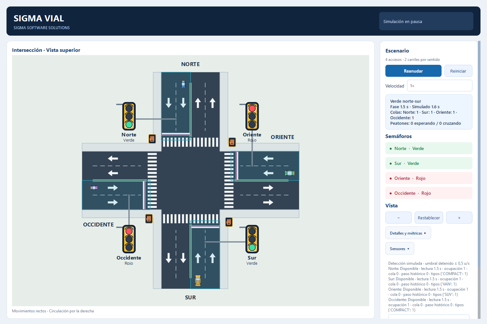
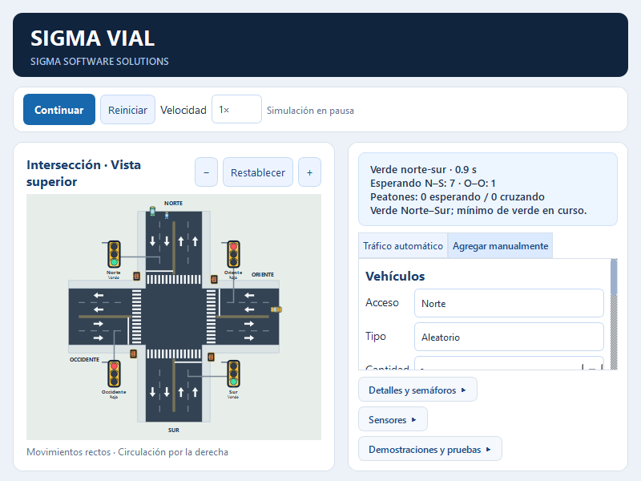
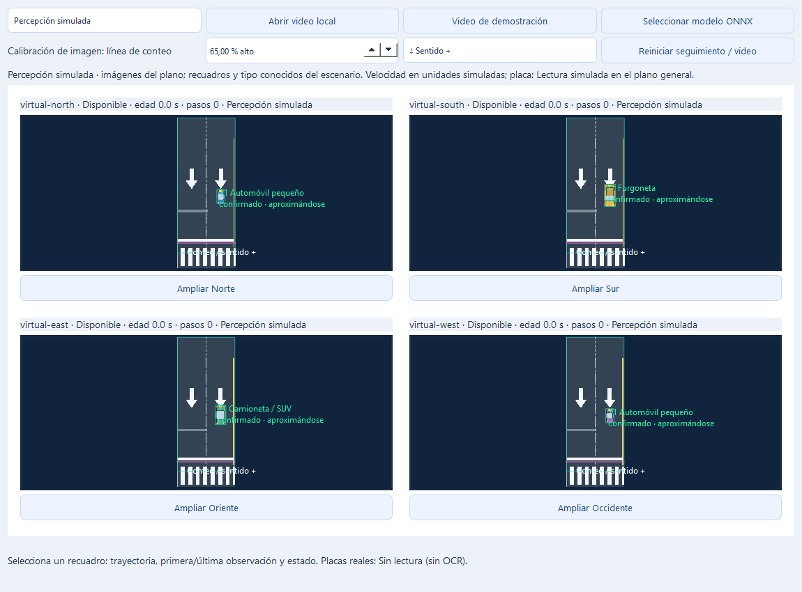
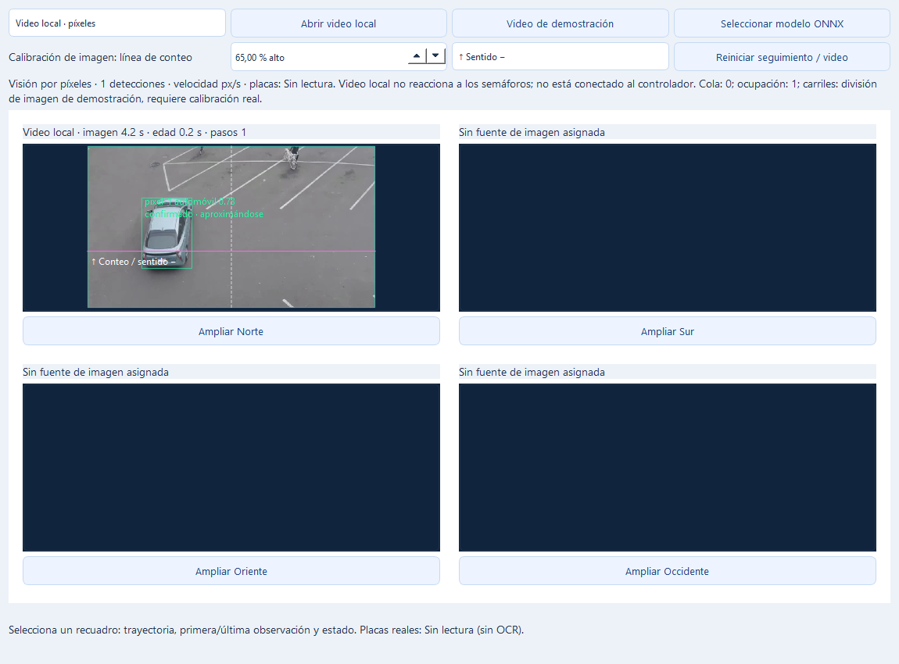

# SIGMA VIAL

Aplicación de escritorio de **SIGMA SOFTWARE SOLUTIONS** para una futura simulación
vial virtual. Estado actual: entorno, interfaz vectorial y primera simulación virtual local ejecutable.

## Preparación en Windows / PowerShell

Se utiliza **CPython 3.14 de 64 bits** (validado con 3.14.7). El paquete admite
exclusivamente la serie 3.14 por ahora; ampliar ese rango requiere validación.
Se necesitan Git, Python con `venv` y acceso a PyPI durante la instalación.
No hace falta instalar Qt por separado, activar PowerShell ni cambiar su política.

Desde la carpeta del proyecto:

```powershell
Set-Location 'C:\Users\USUARIO\Desktop\DESARROLLO\05_PYTHON\SIGMA_VIAL_SIMULATOR'
# Si Python está instalado en otra ubicación, ajustar únicamente esta ruta.
& "$env:LOCALAPPDATA\Python\pythoncore-3.14-64\python.exe" -m venv .venv
.\.venv\Scripts\python.exe -m pip install --require-hashes -r requirements-dev.lock
.\.venv\Scripts\python.exe -m pip install --no-deps --no-build-isolation -e '.[dev]'
.\.venv\Scripts\python.exe -m pip check
.\.venv\Scripts\python.exe -m sigma_vial
```

Si `.venv` ya existe, comprobar primero `.\.venv\Scripts\python.exe --version`
y reutilizarlo si corresponde a Python 3.14. No es necesario recrearlo.
La instalación editable permite importar `sigma_vial` desde cualquier carpeta sin
configurar `PYTHONPATH`. También instala el lanzador `.\.venv\Scripts\sigma-vial.exe`.

## Dependencias y reproducibilidad

`pyproject.toml` es la fuente de declaración de dependencias, rangos y herramientas.
`requirements-dev.lock` se genera desde ese archivo con pip-tools y fija versiones
y hashes de dependencias directas, transitivas y herramientas de construcción.
El bloqueo está destinado a Windows x64 con Python 3.14; no certifica otras plataformas.
La instalación anterior usa las herramientas de construcción fijadas en el entorno
mediante `--no-build-isolation` y evita resolver de nuevo el paquete editable.

Para actualizar, editar los rangos en `pyproject.toml` solo cuando sea necesario y ejecutar:

```powershell
.\.venv\Scripts\python.exe -m piptools compile --extra dev --allow-unsafe --generate-hashes --upgrade --output-file requirements-dev.lock pyproject.toml
.\.venv\Scripts\python.exe -m pip install --require-hashes -r requirements-dev.lock
.\.venv\Scripts\python.exe -m pip install --no-deps --no-build-isolation -e '.[dev]'
.\.venv\Scripts\python.exe -m pip check
```

Revisar el diff del bloqueo y repetir las verificaciones antes de integrar cambios.
Para regenerarlo sin solicitar actualizaciones, omitir `--upgrade`.
No editar manualmente el archivo generado ni copiar listas alternativas de versiones.

Compatibilidad consultada en fuentes oficiales:
[Qt for Python](https://doc.qt.io/qtforpython-6/gettingstarted.html),
[metadatos PySide6](https://pypi.org/project/PySide6/),
[pytest](https://docs.pytest.org/en/stable/getting-started.html),
[pytest-qt](https://github.com/pytest-dev/pytest-qt) y
[Ruff](https://docs.astral.sh/ruff/faq/).
Se eligió un intérprete instalado de la serie 3.14, en lugar del predeterminado 3.15.
La resolución de paquetes y las pruebas locales complementan esa comprobación.

## Verificación y formato

```powershell
.\.venv\Scripts\python.exe -m pytest
.\.venv\Scripts\python.exe -m ruff check .
.\.venv\Scripts\python.exe -m ruff format --check .
# Aplicar formato cuando se edite código:
.\.venv\Scripts\python.exe -m ruff format .
```

Las pruebas comprueban textos, construcción, apertura, cambio de tamaño y cierre,
cuatro accesos, 16 carriles, sentidos de las flechas realmente dibujadas, cuatro
semáforos inicialmente rojos, colores renderizados por estado y controles de zoom.
También verifican pausado, reanudación, reinicio, velocidad, sincronización de
entidades, escenarios, separación de cola, salida bloqueada, despeje y que los
semáforos y rótulos no invadan las calzadas.
Las importaciones se prueban en procesos independientes con tiempo límite, sin
crear una QApplication. pytest-qt administra su propia aplicación y no deja un
bucle gráfico bloqueado. En equipos sin pantalla se puede establecer temporalmente
`$env:QT_QPA_PLATFORM = 'offscreen'`; eso no constituye verificación visual.
Retirar esa variable con `Remove-Item Env:QT_QPA_PLATFORM` antes de abrir la ventana.
En Windows, el control de zoom automatizado prueba la vista sin mostrar otra ventana
nativa durante el ciclo de eventos de pytest. Mostrar la vista en esa prueba producía
`Windows fatal exception: 0x8001010d` en `pytestqt.plugin._process_events`; el proceso
seguía reportando pruebas aprobadas. La prueba conserva las comprobaciones de zoom y
encuadre, y la apertura nativa se valida por separado ejecutando la aplicación normal.

## Organización

- `src/sigma_vial/domain/`: accesos, configuración de carriles y estados de luz; sin Qt.
- `src/sigma_vial/application/`: futura coordinación de casos de uso.
- `src/sigma_vial/presentation/`: composición de la ventana (`main_window.py`),
  geometría común (`geometry.py`), pavimento y marcas (`road_items.py`), semáforo
  reutilizable (`traffic_light.py`), escena (`intersection_scene.py`) y vista
  con encuadre y zoom (`intersection_view.py`).
- `src/sigma_vial/infrastructure/`: futuros adaptadores externos.
- `src/sigma_vial/bootstrap.py`: composición y ciclo de vida de QApplication.
- `src/sigma_vial/__main__.py`: ejecución mediante `python -m sigma_vial`.
- `tests/`: pruebas automáticas y contratos de importación.

El motor determinista está en `src/sigma_vial/domain/simulation.py`; la ventana
coordina el temporizador y dibuja entidades desde el estado del motor.

## Simulación funcional

Intersección ficticia en “+” con accesos norte, sur, oriente y occidente; cada acceso
tiene un semáforo vehicular, dos carriles de entrada y dos de salida. El motor mueve
vehículos y peatones virtuales, decide por demanda, espera y ocupación, y administra
fases de inicio, pausa, reinicio y despeje.

Supuestos del modelo: solo movimientos rectos; norte-sur comparte fase y
oriente-occidente comparte otra. Los peatones tienen fase exclusiva con admisión y
despeje separados. Implementado:

- Cruce en “+” con norte arriba, sur abajo, oriente a la derecha y occidente a la izquierda.
- Dos carriles de entrada y dos de salida por brazo (8 + 8 en total), circulación
  por la derecha, flechas rectas, separación de sentidos y líneas discontinuas.
- Aceras, cuatro pasos peatonales y detención antes del paso en cada entrada.
- Cuatro semáforos etiquetados, inicialmente rojos, sincronizados con las fases del
  motor y los dos carriles de entrada de cada acceso.
- Vehículos vectoriales con aceleración, frenado, cola espaciada y salida tras despejar
  el cruce; peatones vectoriales visibles en los pasos y aceras. El indicador de fase,
  colas, peatones y luces se actualiza desde el estado de la simulación.
- Controles principales siempre visibles para iniciar, pausar/reanudar, reiniciar,
  velocidad y vista. Las pestañas separan tráfico automático y altas manuales;
  las métricas, sensores y demostraciones se despliegan aparte.
- El escenario inicial equilibrado genera 12 vehículos/minuto por acceso y 2,4
  peatones/minuto. Las llegadas empiezan al pulsar Iniciar y pueden ajustarse.
- Ajuste de escena al redimensionar, tamaño mínimo de ventana de 800 × 600 unidades
  lógicas y desplazamiento vertical del panel cuando falta espacio. Para inspeccionar
  detalles en ventanas pequeñas, usar Acercar y después Restablecer vista.
- Gráficos vectoriales locales con QGraphicsScene/QGraphicsView. La aplicación
  instalada funciona sin internet y no depende de la captura para dibujar el cruce.

La simulación implementa avance determinista con pasos de 0,05 s, semilla configurable,
demanda por cada acceso y medición por los dos ejes. La demanda pendiente incluye
vehículos detenidos, aproximándose y llegadas diferidas; los que salen del cruce no
cuentan para retener el verde. Después del mínimo de verde se comparan cantidades y
esperas; la diferencia debe persistir 1 s, mientras la espera máxima tiene prioridad.
Un carril activo vacío durante 4 s solicita el relevo. Si ambos ejes esperan, el verde
continuo se limita a 32 s. Sin demanda incompatible ni peatones, el verde puede
mantenerse. El contador del verde comienza al habilitar la fase y no se reinicia con
nuevas llegadas. Los parámetros (verde mínimo 8 s, amarillo 3 s, despeje 2 s,
admisión peatonal 8 s) son supuestos didácticos, no tiempos certificados para una vía.

La posición de parada se comparte con la geometría de dibujo y descuenta la mitad de
la longitud del vehículo y un margen de 4 unidades: la carrocería queda antes de la
línea, que está antes de la cebra. Las filas conservan al menos 8 unidades entre
carrocerías. Al cambiar de fase, amarillo cierra nuevas admisiones; los vehículos
comprometidos pueden entrar y el rojo de despeje espera a que la parte trasera de
cualquier vehículo comprometido salga de la zona de conflicto. Una salida bloqueada
impide la entrada y el vehículo recupera el movimiento al liberarla.

El panel de detalles muestra demanda pendiente por eje, detenidos y aproximándose,
vehículos saliendo, espera máxima por eje, duración del verde y motivo de decisión.

La interfaz incluye iniciar, pausar/reanudar, reiniciar conservando tasas de demanda,
ritmo 0,5×/1×/2×/4×, demanda en vehículos/minuto y peatones/minuto, incorporación
manual y escenarios reproducibles cargados en pausa. Dibujos, luces y métricas proceden
del motor. Acercar, alejar y restablecer vista son independientes del reloj simulado.

Parámetros pendientes de mayor validación: restricciones reales de capacidad de las
salidas por carril, geometría individual de los cuatro cruces peatonales, calibración
de velocidades y políticas de espera bajo obstrucciones prolongadas. La demostración
no representa seguridad vial certificada. Hardware ESP32 y semáforos físicos siguen
fuera de alcance.
No utiliza cámaras, IA, nube, bases de datos ni hardware. ESP32 y semáforos físicos
se considerarán en una etapa posterior.

## Ramas y próxima etapa

La preparación del entorno está en el commit `5806bd6`
(`setup/development-environment`). La interfaz se desarrolló en `feature/intersection-ui`; la simulación funcional se
desarrolla en `feature/functional-simulation`.

Siguiente etapa: integración física, cuando la simulación local quede revisada e integrada.

## Revisión de la interfaz

La captura real de la ventana se guarda en
[`docs/intersection-ui.png`](docs/intersection-ui.png).
La revisión manual y los resultados de esta entrega están documentados en
[`docs/validation-intersection-ui.md`](docs/validation-intersection-ui.md).


## Tráfico mixto y presentación visual

En **Tráfico automático**, el selector de tipos permite **Aleatorio** o Moto,
Automóvil pequeño, Sedán, Camioneta/SUV, Furgoneta, Bus, Camión pequeño y Camión
grande. Afecta tanto a llegadas automáticas como a incorporaciones manuales.
El porcentaje de buses y camiones ajusta la mezcla aleatoria (10 % inicialmente);
los demás tipos mantienen sus proporciones relativas. Reiniciar conserva esta selección.
Cada vehículo cuenta como una unidad de demanda, independientemente de su tamaño.

Las longitudes van de 20 a 88 unidades y los anchos de 9 a 26, dentro de carriles
de 58 unidades. El catálogo del dominio centraliza velocidad, aceleración y frenada.
El dibujo recibe las mismas dimensiones: se calculan frente, parte trasera,
separación entre carrocerías (8 unidades), espacio de aparición, capacidad mínima
de salida y eliminación después de salir completamente. Los vehículos lentos
siguen limitando a sus seguidores también dentro del cruce y en la salida.
Las salidas bloqueadas siguen impidiendo nuevas entradas; no hay cambios de carril.

Los cuatro semáforos vehiculares tienen carcasa amarilla, panel oscuro, viseras
y soportes horizontales. Cuatro indicadores peatonales adicionales muestran una
mano naranja al detenerse y una persona blanca exclusivamente durante admisión.
Durante despeje no se permite iniciar; quienes cruzan terminan antes del verde
vehicular. Los peatones en espera se distribuyen en la acera; el color turquesa
identifica a quienes cruzan y el violeta a quienes esperan.


Validación de esta entrega: pruebas de filas mixtas, los ocho tipos en los cuatro
accesos, capacidad de salida, despeje trasero del camión, dimensiones gráficas,
indicadores, pausa y reinicio. Se ejecutó Qt con plataforma `windows`, se renderizó
la captura, se ejercitaron zoom repetido y tamaños 1500×1000 y 800×600 mediante
controles programáticos. Una medición de 120 segundos simulados con actualización
de entidades, luces y métricas tomó aproximadamente 1,8 segundos de CPU/tiempo
transcurrido en esta máquina (55 vehículos y 7 peatones al finalizar); no es una
medición de FPS ni una revisión humana continua del movimiento. Los tamaños y
prestaciones son didácticos, no una calibración de vehículos reales.


## Percepción simulada y placas sintéticas

**Sensores** despliega estado y última lectura de las cuatro cámaras virtuales,
ocupación actual, cola (velocidad ≤ 0,5 unidades/s), tipos observados y paso histórico.
La lectura es configurable entre 0,05 y 1 segundo simulado. La casilla de cobertura
muestra zonas turquesa y líneas de paso magenta; no son imágenes de una cámara real.
Cada sensor cubre los dos carriles de entrada de su acceso, desde posición longitudinal
0 a 270; la línea de conteo está en 250. La salida del área de cobertura elimina la
detección activa en la lectura siguiente. La demanda excluye entidades que ya cruzan
o salen y no se confunde con el acumulado histórico de pasos. El seguimiento público
usa identificadores propios de cámara, distintos del identificador del mundo.

`domain/perception.py` define `ObservationSource`, `ObservationBatch`, `Detection`,
`SensorStatus` y `TrafficSummary`. El adaptador `SimulatedObservationSource` obtiene
observaciones de entidades internas, filtradas por cobertura y frecuencia. No ejecuta
clasificación de píxeles, OCR ni reconocimiento real de imágenes. La fuente define
también observaciones de espera peatonal. El controlador consulta demanda, espera y
estado a través del contrato; las entidades completas se conservan para movimiento,
distancias y protección del cruce. Esas protecciones son capacidades del simulador,
no de las cámaras. Las llegadas diferidas fuera del mundo visible no son detecciones.

**Sin datos no significa vacío.** Si falta una de las cuatro lecturas, su estado es
sin datos/desconectado, o la antigüedad supera 1 segundo simulado, se solicita amarillo
y luego rojo; no se habilita otra fase hasta recuperar las observaciones válidas.
Quienes están comprometidos terminan de salir y los peatones siguen protegidos por
el estado del mundo. Las últimas lecturas se conservan hasta la siguiente muestra,
no indefinidamente como demanda válida. Pausar detiene el reloj, el movimiento y las
lecturas; reiniciar limpia seguimientos, contadores y registro de placas.

Una futura fuente de imágenes implementará el mismo contrato, entregando detecciones,
seguimientos, tiempos y disponibilidad. Puede usar tipo desconocido y confianza
opcional; el contrato admite `confidence=None`. Debe aportar su propia lectura de
peatones. El argumento de mundo del adaptador simulado puede ignorarse en una fuente
externa. No se incorporan dependencias de visión ni hardware en esta etapa.

`domain/catalog.py` es el catálogo Python local, ampliable y validado: identificador
de modelo, tipo, marca/modelo ficticios, dimensiones, prestaciones y variante gráfica.
No es un conjunto de entrenamiento. Al seleccionar un vehículo, **Datos del escenario**
muestra tipo, marca, modelo y placa; la detección actual aparece separada. El detector
no deduce marca o modelo de una imagen.

`PlateService` genera identificadores ficticios de formato colombiano: `ABC123` para
vehículos de cuatro ruedas y `ABC12D` para motos. No corresponden necesariamente a
vehículos registrados. El registro de sesión impide reutilizarlos incluso después
de salir de escena, y una semilla reproduce la secuencia. Incorporación manual,
llegadas automáticas y escenarios usan el mismo servicio. Reiniciar puede reutilizar
la secuencia porque empieza una sesión nueva. Las placas están en los datos del
vehículo, en amarillo/negro cuando la escala lo permite y completas en la selección.
El sensor las etiqueta **Lectura simulada**. Un sistema externo necesitará un módulo
independiente de lectura de placas; detectar, contar y seguir no depende de leerlas.



Se verificó arranque y cierre con Qt `windows`, avance mediante temporizador nativo,
pausa, selección con placa completa y detección diferenciada, reinicio y cambio de
tamaño/zoom mediante controles programáticos. La captura se revisó visualmente;
no se afirma una revisión humana continua del movimiento ni validación de cámaras reales.


## Generación automática e incorporación manual

La barra fija encima del plano incluye **Iniciar / Pausar / Continuar**, **Reiniciar**,
velocidad y estado. Zoom y restablecimiento están junto al plano. Cambiar de pestaña
solo cambia el formulario visible: ambas fuentes de llegada pueden coexistir y el
control semafórico sigue siendo automático, basado en sensores.

**Tráfico automático** tiene un interruptor independiente y cinco perfiles. Elegir
uno aplica inmediatamente las tasas a las llegadas futuras y a los campos, sin borrar
entidades, modificar la fase ni reiniciar el reloj. Editar una tasa selecciona
**Personalizado**. Las tasas son por acceso, no por carril.

| Perfil | Norte | Sur | Oriente | Occidente | Peatones/min |
| --- | ---: | ---: | ---: | ---: | ---: |
| Equilibrado | 12 | 12 | 12 | 12 | 2,4 |
| Mayor tráfico Norte–Sur | 18 | 18 | 3 | 3 | 2,4 |
| Mayor tráfico Oriente–Occidente | 3 | 3 | 18 | 18 | 2,4 |
| Más peatones | 4 | 4 | 4 | 4 | 12 |

Las columnas vehiculares están en vehículos/minuto. El selector de tipos y el
porcentaje de buses/camiones configuran exclusivamente las nuevas altas automáticas;
la pestaña manual usa su propio selector. Los ajustes avanzados están plegados al
inicio y explican la política de solicitudes.

**Al apagar la generación**, se congelan los acumuladores de llegadas nuevas, tanto
vehiculares como peatonales. No se acumulan llegadas durante el apagado ni se produce
una ráfaga para recuperar ese tiempo al encenderla. Se conserva la fracción de llegada
que ya había transcurrido. Las solicitudes completas pendientes, automáticas o
manuales, siguen intentando incorporarse cuando hay espacio: conservan su tipo en
una cola por acceso, no se descartan al apagar. Las entidades presentes siguen
moviéndose si la simulación está iniciada. Pausar congela el tiempo y esos reintentos.

**Agregar manualmente** contiene dos formularios: acceso, tipo y cantidad de
vehículos; paso y cantidad de peatones. Cada botón admite entre 1 y 100 solicitudes.
La confirmación informa cuántos vehículos entraron y cuántos quedaron pendientes por
falta de espacio. Los peatones se incorporan en la acera y esperan su fase. La placa
se asigna al materializar un vehículo y conserva unicidad dentro de la sesión.
Cambiar de pestaña conserva los valores; reiniciar limpia el mundo y sus solicitudes,
pero conserva las tasas, mezcla y estado del interruptor automático.

El resumen fuera de las pestañas muestra fase, vehículos pendientes por eje, peatones
en espera/cruzando y motivo actual. **Detalles y semáforos**, **Sensores** y
**Demostraciones y pruebas** son desplegables independientes. Las demostraciones son
casos técnicos, separados de los perfiles: al cargarlas se borra el mundo, reinicia
el tiempo y se deja detenido. Una advertencia visible explica ese efecto. Cada caso
define sus tasas desde cero, mezcla, tipo y generación habilitada, de modo que no
hereda la configuración de la demostración anterior.




Validación: pruebas de pestañas sin efectos, perfiles durante ejecución, campos y tasas,
automático desactivado, solicitudes mixtas y múltiples, capacidad insuficiente,
conservación de tipo en pendientes, pausa/reinicio y placas. Se ejecutó la ventana con
Qt nativo `windows`, temporizador, cambio de perfil, apagado automático, incorporación
manual y reinicio programáticos. Las capturas de 1500×1000 y 800×600 se revisaron
visualmente. En la ventana pequeña se desplazan los formularios y los diagnósticos,
mientras la barra general permanece visible; no se afirma una prueba humana continua.


## Centro de monitoreo y laboratorio de visión

El botón **Centro de monitoreo**, en la barra general, abre una ventana independiente
sin detener el cruce. En **Percepción simulada** aparecen cuatro imágenes del plano,
una por acceso, con cobertura, carriles, línea/sentido de conteo, estado, antigüedad,
recuadros, tipo, movimiento e ID. **Ampliar** abre una vista mayor. Seleccionar un
recuadro muestra primera/última observación, estado y trayectoria. El plano y su
selección conservan los datos del escenario separados de los observados.

La ruta real de imágenes es opcional. Desde la raíz del repositorio:

```powershell
.\.venv\Scripts\python.exe -m pip install -e ".[dev,vision]"
.\.venv\Scripts\python.exe -m sigma_vial
```

- **Video de demostración** reproduce el pequeño extracto incluido y ejecuta YOLOX
  sobre sus píxeles. También se puede **Abrir video local**. No se envía ese video a
  servicios externos y no se descarga nada al arrancar la aplicación.
- **Captura del simulador · prueba de píxeles** envía imágenes de la vista Norte al
  mismo detector. Los dos modelos evaluados fallaron en los dibujos actuales; esta
  opción es experimental y no reemplaza a la percepción simulada del controlador.
- Los otros tres recuadros indican que no tienen fuente asignada en el laboratorio
  de un video, para evitar representar una única grabación como cuatro cámaras.
- Línea de conteo y sentido son configurables. La velocidad es **px/s**, nunca km/h;
  la cola es un conteo de vehículos con velocidad estimada ≤ 3 px/s, no metros.
  No se calcula velocidad al primer avistamiento; se confirma con otra observación.
- Solo se exponen las categorías del modelo: automóvil, motocicleta, bus y camión.
  No se deducen marca/modelo ni se muestran confianzas inventadas. Placas: **Sin
  lectura**, porque no hay un módulo de detección de placa/OCR. La lectura sintética
  del escenario conserva su etiqueta **Lectura simulada** y no completa videos.

`ImageSource`/`ImageFrame` permiten incorporar posteriormente una fuente externa.
El detector y `ImageTracker` reciben exclusivamente imágenes/tiempos y calibración;
no consultan entidades del simulador. `traffic_from_tracks` convierte sus resultados
al contrato `TrafficSummary` existente, separando cola, ocupación, demanda y paso
histórico. El laboratorio utiliza ese resumen para mostrar métricas, pero **no
conecta la grabación al control del cruce**. No se implementa reproducción de demanda
en esta etapa: los vehículos filmados no reaccionan a nuestros semáforos. El
control automático existente sigue usando sus cámaras simuladas y las protecciones
del mundo; no se altera la política de respaldo por ausencia de observaciones.

Las imágenes se procesan fuera del hilo gráfico: un trabajador, un fotograma en curso
y sin cola creciente. Se saltan solicitudes cuando está ocupado. Fin de video
finaliza detecciones activas y se identifica como ausencia de imagen. Los dibujos del
cruce se capturan en el hilo de Qt, pero la inferencia y decodificación de video se
realizan en el trabajador. No se conectó hardware ni se entrenó un modelo.

La comparación visual, errores, límites y tiempos están en
[`docs/vision-evaluation/REPORT.md`](docs/vision-evaluation/REPORT.md). Para repetirla:

```powershell
.\.venv\Scripts\python.exe tools/evaluate_vision.py
```

YOLOX localizó las cinco apariciones del automóvil en la pequeña muestra real;
NanoDet una. Ambos omitieron los dos automóviles dibujados. Esto no demuestra precisión
general. Modelos, código y pesos: Apache-2.0 de OpenCV Zoo; extracto de video:
CC BY 4.0 de Intel IoT DevKit/sample-videos, con crédito y cambios documentados en
[`assets/vision/CREDITS.md`](assets/vision/CREDITS.md). La ruta fue comprobada con
Python 3.14, OpenCV headless 5.1.0.95 y NumPy 2.5.5 en Windows/CPU; no requiere GPU.
OpenCV 5 puede emitir un aviso sobre `setPreferableTarget`; las inferencias evaluadas
terminaron correctamente en CPU. Los pesos se ubican en `assets/vision` desde la raíz
fuente; una instalación redistribuible necesitará empaquetar esos recursos o seleccionar
el archivo ONNX compatible con YOLOX mediante el botón del centro de monitoreo.





El fotograma de video dentro de la última captura deriva del clip CC BY 4.0 citado;
se distribuye con esa licencia y atribución. Las pruebas de seguimiento y la revisión
de capturas complementan la evaluación anotada; no sustituyen una validación de
precisión con cámaras representativas, ni una prueba humana continua de operación.

### Monitoreo: sesiones y retención

Cada cambio de seguimiento, modo o sesión invalida los trabajos anteriores mediante una generación. Un resultado pendiente nunca restaura el reloj de la sesión anterior. Las ventanas se destruyen al cerrarlas; los puntos por trayectoria se limitan a 128 y los seguimientos sin observaciones caducan a los 10 segundos. Los mapas de cámaras simuladas retienen únicamente vehículos presentes; el contador acumulado se conserva. El registro de placas usadas es independiente y no se poda con los historiales.

### Registro persistente de vehículos ficticios

La aplicación registra cada incorporación (manual, automática o demostración) en SQLite antes de mostrarla. Placa PRIMARY KEY/UNIQUE, tipo, marca y modelo del catálogo ficticio, color hexadecimal del dibujo y dimensiones en unidades simuladas. Las colisiones entre sesiones se resuelven generando otra placa e intentando la inserción atómica; reiniciar no borra filas. Ubicación Windows: `%LOCALAPPDATA%/SIGMA SOFTWARE SOLUTIONS/SIGMA VIAL/vehicles.sqlite3`; `SIGMA_VIAL_REGISTRY` permite elegir otra ruta (las pruebas siempre usan archivos temporales). No es un registro oficial. El motor sin adaptador SQLite conserva su modo determinista en memoria.

### Cámara trasera sintética

El renderizador `rear_camera` crea una imagen RGB frontal al plano trasero del vehículo. La escala y posición dependen de su avance, con una placa amarilla de al menos 200 × 45 píxeles en cobertura. La imagen se etiqueta sintética: el renderizador usa la placa para dibujarla, nunca para reconocerla. El recorte sale de la geometría conocida, no de YOLOX ni de un localizador aprendido. Sin vehículo produce una imagen vacía de vehículos y ningún recorte. Es una proyección simplificada, no una cámara fotorealista ni una recuperación desde la vista cenital.

### OCR local independiente (Tesseract)

Instalar en Windows: `winget install --id UB-Mannheim.TesseractOCR --exact --silent --accept-package-agreements --accept-source-agreements`. Versión evaluada 5.4.0.20240606 (instalador verificado por winget SHA256 `c885fff6998e0608ba4bb8ab51436e1c6775c2bafc2559a19b423e18678b60c9`). El ejecutable externo evita ABI de Python; probado en Python 3.14.7 / Windows. Se descubre en PATH, Program Files o con `SIGMA_VIAL_TESSERACT`. Sin instalación el monitoreo informa indisponibilidad; los semáforos no dependen del OCR.

Motor [Tesseract](https://github.com/tesseract-ocr/tesseract) y [modelos eng](https://github.com/tesseract-ocr/tessdata) Apache-2.0; documentación y licencia oficial en sus repositorios. Modelo eng instalado SHA256 `7d4322bd2a7749724879683fc3912cb542f19906c83bcc1a52132556427170b2`; no se redistribuyen ejecutables/DLL/modelos en Git. El paquete Windows contiene bibliotecas con sus propios avisos: conservar los de la instalación.

`TesseractPlateReader.read(png, timestamp)` solo recibe bytes y tiempo (configuración: ejecutable, tessdata, confianza y timeout). Usa LSTM eng, PSM 7, alfabeto alfanumérico y acepta únicamente formatos colombianos a partir de confianza 40. No sustituye caracteres ambiguos, consulta catálogo ni accede a placas del motor. Sin imagen: “Sin lectura”; texto inválido o baja confianza: “No legible”. La confirmación exige tres observaciones consecutivas iguales con tiempos distintos; se invalida con lectura diferente o fallida y caduca tras 10 s. YOLOX sigue siendo detector de vehículos, sin OCR.

Evaluación reproducible: `python tools/evaluate_ocr.py`; imágenes y resultados en `docs/ocr-evaluation`. Motor real: 14/16 recortes con placa exactos; dos rechazos de NSD900 (texto bruto NSD960, confianza < 40), más 2/2 negativos sin placa aceptada. Son ocho textos sintéticos del catálogo de tipos en dos posiciones, no dieciséis placas independientes ni una medición con cámaras reales. Los fallos quedan publicados; no se corrigen usando el texto esperado. La suite separa la prueba real (se omite explícitamente si falta Tesseract) de pruebas de consenso con dobles.
